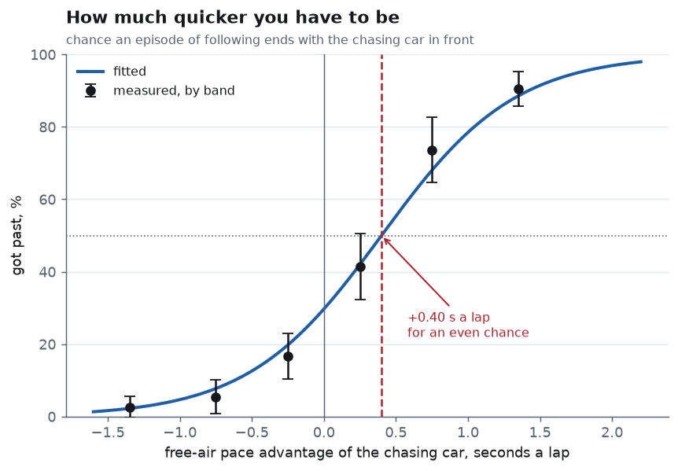
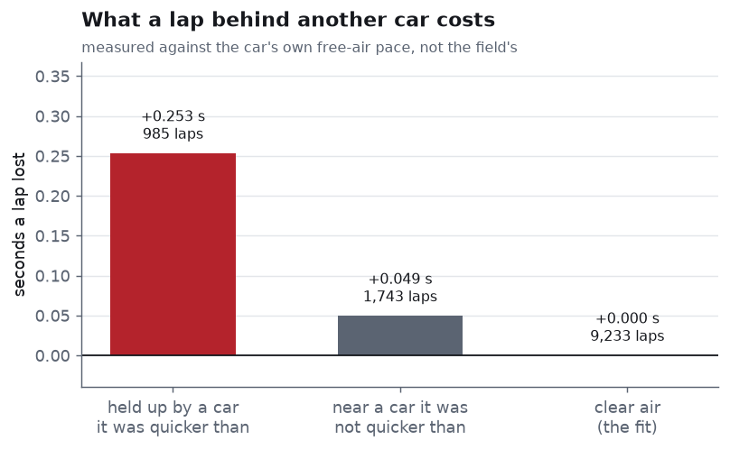
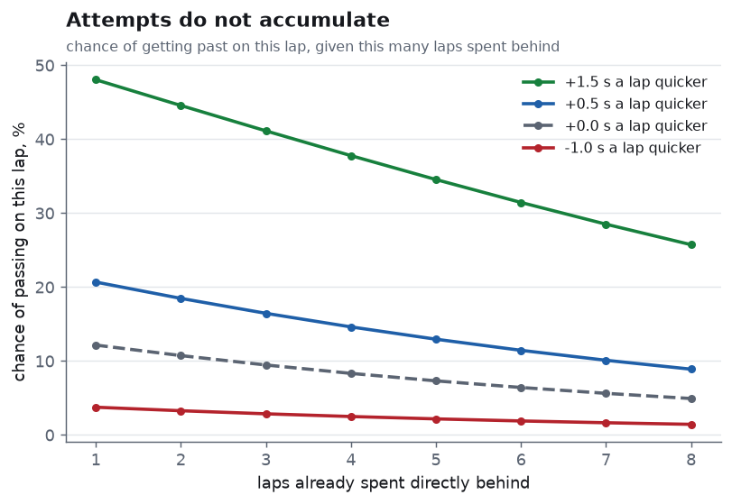
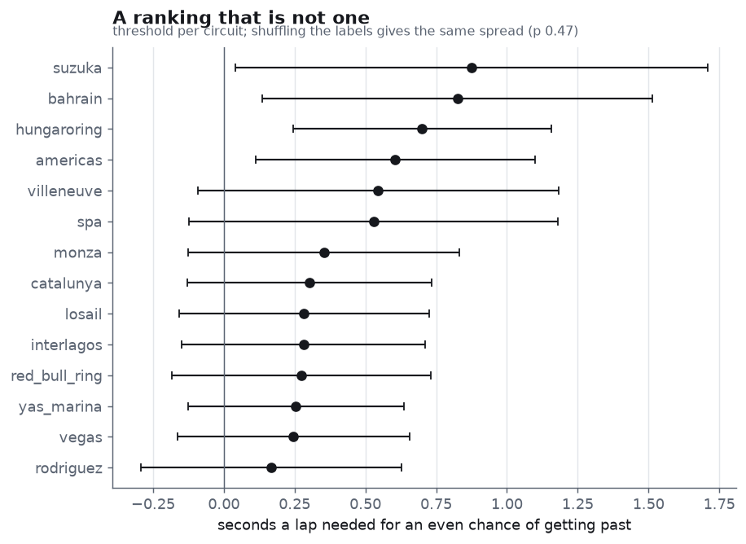
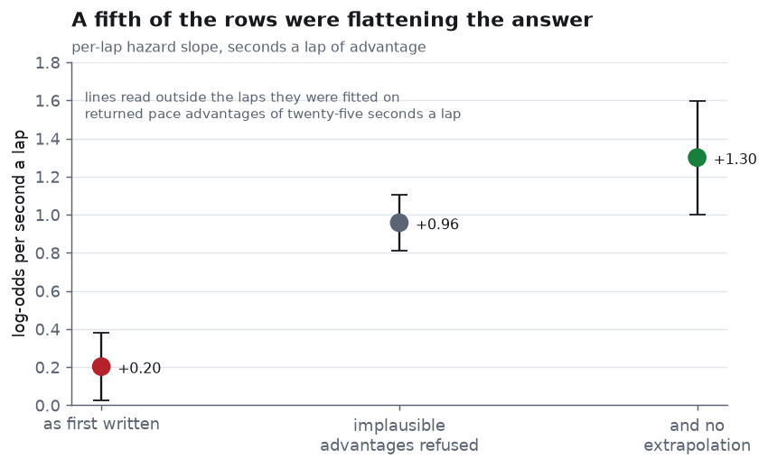
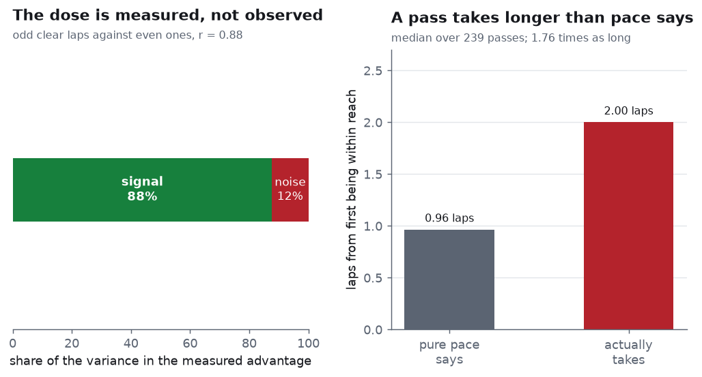

# Pace to pass

How much quicker a Formula 1 car has to be to get past the one in front,
measured from 24,386 lap times and nothing else — no telemetry, no sector
data, no gap feed, no positional feed.

The project before this one,
[undercut-effect](https://github.com/Pratsss24/undercut-effect), ended on
the finding that getting ahead is worth **+4.14 s** of avoided payback,
because a car that is now slower on pace simply doesn't lose the place —
the quicker car is stuck behind it. This asks the obvious next question:
*how* stuck, and at what price.

```
pace needed to get past     +0.40 s a lap, for an even chance
cost of being held up       +0.25 s a lap  (merely being near: +0.05)
a pass takes                1.76x as long as pure pace says
circuit differences         p 0.47 - one season cannot resolve them
order from lap times        agrees with the reported position on 23,956 of 23,956 laps
```

---

## The race order is in the lap times, exactly

Summing a car's lap times gives its elapsed race time at the end of every
lap. Sorting cars by that total at lap *n* puts them in the order they
crossed the line on lap *n* — that is the race order — and the difference
between two neighbours is the gap between them.

The feed also reports a position, which makes this checkable rather than
merely plausible:

| | laps |
|---|---|
| order from lap times agrees with the reported position | **23,956** |
| disagrees | **0** |

Not 99.8%. Every lap of the season. Everything below is built on that one
identity, and it needed no positional feed to get there.



---

## The problem: the dose cannot be measured where the effect happens

A car stuck behind another is *slowed by being stuck behind it*. So the
pace difference measured while two cars run together is attenuated by
exactly the effect this project is trying to measure. Using it would be
circular, and the circularity runs in the direction that makes passing
look harder than it is.

**So pace is measured apart and tested together.** Each car-race gets a
line fitted to the laps it ran in clear air:

```
seconds  =  base  +  wear × age  +  burn × lap
```

The advantage of one car over another is the difference of two such
lines, each read at that car's own tyre age on that lap — so fuel and
tyre state are held level by construction, not by a covariate. That
matters, because a car that has just stopped is quicker than the car
ahead for reasons that have nothing to do with whether it can pass.

As a check that these lines are not noise: the fitted field spans
**2.57 s a lap** at the median race, which is what a Formula 1 grid
actually covers.

---

## Finding 1 — +0.40 seconds a lap

| free-air advantage | episodes | got past |
|---|---|---|
| −1.0 or worse | 115 | 2.6% ± 2.9 |
| −1.0 to −0.5 | 92 | 5.4% ± 4.6 |
| −0.5 to 0 | 132 | 16.7% ± 6.4 |
| 0 to +0.5 | 111 | **41.4% ± 9.2** |
| +0.5 to +1.0 | 91 | **73.6% ± 9.1** |
| +1.0 or better | 148 | **90.5% ± 4.7** |

No model in that table. Fitted, with errors clustered on the episode:

| term | estimate | 95% interval | p |
|---|---|---|---|
| base | +0.0125 | −0.5287 to +0.5538 | 0.964 |
| **per second a lap of advantage** | **+2.1552** | **+1.7314 to +2.5790** | 0.000 |
| per second of opening gap | −0.7067 | −1.1044 to −0.3091 | 0.0005 |

McFadden 0.424, and the curve passes through all six measured bands.

At the mean opening gap of 1.24 s, the fitted curve crosses even odds at
**+0.40 seconds a lap**. Below that, a car behind is more likely than not
to stay behind however long it sits there.

**The intercept is worth a look on its own.** It comes out at +0.0125 —
two cars of identical pace running nose to tail are a coin toss. That is
what it physically ought to be, and nothing in the fit imposed it. A
model that got this wrong would be suspect whatever else it said.

---

## Finding 2 — being near a car is free; being held up by one is not



| laps | against the car's own free-air pace |
|---|---|
| held up by a car it was quicker than (985) | **+0.253 s a lap** |
| near a car it was *not* quicker than (1,743) | +0.049 s a lap |

The second row is the control, and it is what makes the first row mean
something. Pooling every lap within two seconds — the obvious thing to do
— gives **+0.139** and hides the finding, because most such laps are
cars running at a pace they were going to run anyway, sitting behind
someone of similar speed. The cost appears only where the car behind had
the pace to go faster and could not.

---

## Finding 3 — attempts do not accumulate



Per lap of following, rather than per episode:

| term | estimate | 95% interval | p |
|---|---|---|---|
| per second a lap of advantage | +1.2662 | +0.9654 to +1.5669 | 0.000 |
| **per lap already spent trying** | **−0.1402** | **−0.2498 to −0.0306** | 0.012 |
| per second of opening gap | −0.7691 | −1.0491 to −0.4890 | 0.000 |

The time term is **negative**. A car that has not got past in the first
couple of laps is *less* likely to manage it on the next one, not more.
Pressure does not build. Either the move is on early or it isn't on.

And the pass, when it comes, is slow. A car `g` seconds behind and `a`
seconds a lap quicker closes the gap in `g / a` laps — that is the whole
of the pure-pace prediction, and it ignores the car in front entirely:

| | laps |
|---|---|
| pure pace predicts | 0.96 |
| the median pass actually takes | **2.00** |

A ratio of **1.76** over 239 passes, and it *understates* the resistance:
33 more cars were still behind past the lap pace said they would be by,
and never got past at all.

---

## Finding 4 — the circuit makes no measurable difference

This is what the project was built to measure, and the answer is that one
season cannot measure it.



The fitted thresholds run from +0.17 s a lap at Mexico City to +0.87 at
Suzuka. That looks like a ranking — a factor of five. It is not one:

- **Jointly, the 14 circuit terms give F 0.909, p 0.549.** Adding all of
  them moves McFadden from 0.424 to 0.440.
- **Shuffling the circuit labels across episodes** — which destroys any
  real circuit effect and keeps the sample size, the imbalance between
  circuits and the pace distribution exactly as they are — gives a median
  spread of **0.699 s a lap** against the real **0.708**, and beats the
  real spread **47%** of the time.

Two tests that assume quite different things, agreeing. The individual
intervals span about ±0.45 s a lap, so a circuit would have to differ
from average by more than that to show up here, and real circuit
differences are plainly smaller than that. The honest statement is not
"Suzuka is hardest" but "with roughly forty episodes per circuit, this
season cannot tell these circuits apart."

---

## What I got wrong, and what fixed it



**The first version of this said the pace effect was +0.20 and barely
significant** — against raw bands running from 3% to 78%, which should
have been impossible. Two defects, found by checking rather than
assuming:

1. **A per-car line read outside the laps and tyre ages it was fitted on.**
   Within a single stint, tyre age and race lap advance together, so the
   split between those two coefficients is partly arbitrary even when the
   fitted values are good. Extrapolate, and the arbitrariness becomes a
   number — pace advantages of **twenty-five seconds a lap**. Two per cent
   of rows, enough to flatten the central slope by a factor of five.

| | hazard slope | 95% interval |
|---|---|---|
| as first written | +0.203 | +0.024 to +0.382 |
| implausible advantages refused | +0.958 | +0.812 to +1.104 |
| and no extrapolation at all | **+1.300** | +1.003 to +1.597 |

   Tightening the rule further (two laps of slack, then none) stops moving
   the estimate, which is the sign that the guard is doing the right job
   rather than being tuned. It costs about a fifth of the episodes.

2. **I first blamed the wrong thing.** My diagnosis was that controlling
   for the opening gap was blocking the pace channel — a mediator, the
   same mistake as in the undercut project. It was not: the two correlate
   **−0.014**, and dropping the gap moved the slope from +0.193 to
   +0.203 — a five per cent change, where the flatness needed a
   five-*fold* one. The test that pins this says so in its own docstring,
   because a plausible diagnosis that turns out to be wrong is worth
   keeping where the next person can see it.

---

## The dose is measured, not observed



The advantage is an estimate, and a noisy regressor pulls its own slope
toward zero. Fitting each car's line **twice** — once on its odd clear
laps, once on its even ones — gives two independent measurements of the
same quantity:

| | |
|---|---|
| correlation between the halves | **0.877** |
| noise | 0.376 s a lap |
| signal | 1.001 s a lap |
| reliability | **0.876** |

So about 12% of the variation in the dose is measurement error, the true
slope is nearer **2.46** than 2.155, and the real threshold is nearer
**+0.35 s a lap** than +0.40. The headline figure is a slight
*over*statement of how much pace you need, and now by a known amount.

This is a gauge study in all but name, which is the point: a measurement
system with 88% signal is a usable instrument, and one would not know
that without measuring it twice.

---

## What this does not do

- **One season.** 2023 only. The circuit null is mostly a sample-size
  statement, and is the first thing more seasons would change.
- **No DRS, no compounds.** The Ergast schema records neither. A pass
  with DRS down the straight and a pass round the outside are the same
  event here, and some of the spread in the measured threshold is that.
- **Lap resolution.** A pass and a re-pass within the same lap are
  invisible. "Got past" means the order at the timing line flipped, which
  is what the stopwatch says and not necessarily what a steward would say.
- **No way to tell a pass from a mistake.** A car that is slower in free
  air still gets past 2.6% of the time, and this cannot distinguish an
  error by the car ahead from a damaged car, a strategy call or a bad
  pace estimate.
- **Traffic is not modelled.** Only the adjacent pair is measured, so a
  lapped car between two leaders, or a train of four cars, enters only as
  noise.
- **The episodes are not a random sample.** Cars end up close to each
  other for reasons — pit sequence, safety cars, relative pace — and
  nothing here breaks that. The control is a comparison group, not a
  randomisation.

---

## Fachbegriffe

| English | Deutsch |
|---|---|
| overtaking | das Überholen |
| overtaking manoeuvre | das Überholmanöver |
| dirty air | die verwirbelte Luft, die Turbulenz |
| slipstream | der Windschatten |
| track position | die Streckenposition |
| gap (between cars) | der Abstand, der Rückstand |
| elapsed race time | die Gesamtrennzeit |
| free-air pace | die Pace in freier Luft |
| lapped car | der überrundete Wagen |
| tyre age | das Reifenalter |
| fuel burn | der Kraftstoffverbrauch |
| safety car | das Safety Car |
| logistic regression | die logistische Regression |
| discrete-time hazard | die zeitdiskrete Hazardrate |
| log-odds | die Logit-Werte, das logarithmierte Chancenverhältnis |
| censoring | die Zensierung |
| dose-response | die Dosis-Wirkungs-Beziehung |
| threshold | der Schwellenwert |
| collinearity | die Kollinearität |
| extrapolation | die Extrapolation |
| leverage point | der Hebelpunkt |
| attenuation bias | die Abschwächungsverzerrung |
| measurement error | der Messfehler |
| reliability (of a measurement) | die Zuverlässigkeit, die Reliabilität |
| split-half | die Testhalbierung |
| gauge capability study | die Messmittelfähigkeitsuntersuchung |
| permutation test | der Permutationstest |
| joint significance test | der gemeinsame Signifikanztest |
| cluster-robust standard error | clusterrobuster Standardfehler |
| mediator | die Mediatorvariable |
| confounder | die Störgröße |
| separation (in a logit) | die vollständige Trennung |

---

## Layout

```
run.py                       measure, test, report
src/data.py                  the Jolpica/Ergast feed, cached per season
src/stints.py                which laps are usable, and why
src/gaps.py                  elapsed times and the gap between two cars
src/follow.py                following episodes, and how each one ended
src/pace.py                  free-air pace, dirty air, split-half reliability
src/passing.py               the hazard, the episode model, the thresholds
src/linear.py                least squares and logit, cluster-robust
src/charts.py                six figures
src/report.py                the printable PDF report
src/paper.py                 A4 page composition
tests/test_pace_to_pass.py   31 tests
out/                         figures, report.pdf, _run.txt
```

```bash
pip install -r requirements.txt && python run.py && python -m pytest -q
```

`data.py`, `stints.py` and `gaps.py` are carried over from
[stint-degradation](https://github.com/Pratsss24/stint-degradation),
[race-strategy-mc](https://github.com/Pratsss24/race-strategy-mc) and
[undercut-effect](https://github.com/Pratsss24/undercut-effect).

## Sources

- Lap times, pit stops and results: the
  [Jolpica](https://api.jolpi.ca/ergast/f1/) mirror of the Ergast schema.
  Unauthenticated and rate limited.
- Kung-Yee Liang and Scott Zeger (1986) — cluster-robust standard errors.
- Charles Spearman (1904) — the attenuation of a correlation by
  measurement error, which is what the split-half check is for.
